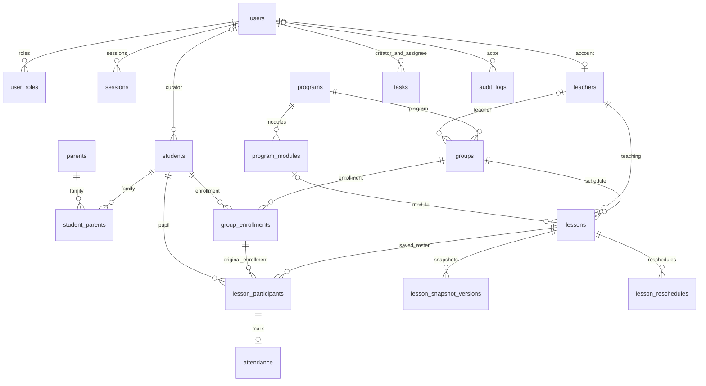

# Схема данных AIQ Core

Состояние после миграции `016_lesson_participants.sql`, 16 октября 2026 года. Использован базовый вариант R10: отдельные модули учеников, родителей и посещаемости, отдельные таблицы сохранённого состава и отметок.

## Основные связи

Задача может иметь одну необязательную связь с учеником, группой или занятием. Она не даёт права читать связанный объект. Дополнительные служебные таблицы — `login_rate_limits` и `schema_migrations`.

## Сохранённый состав и отметки

| Таблица | Поля и назначение |
| --- | --- |
| `lesson_participants` | `id` — identity/PK; `lesson_id`, `group_id`, `enrollment_id`, `student_id`; `student_name` — имя на момент фиксации; `included` — участие в действующем составе; `created_at`, `updated_at` |
| `attendance` | `id` — PK и FK на `lesson_participants.id`; `status`, `comment`, `created_at`, `updated_at`. Группа, зачисление, имя и включение в состав здесь не дублируются |
| `attendance_records` | Представление чтения с объединёнными полями участника и отметки для журнала, Student 360, Dashboard и истории. Запись выполняется через физические таблицы, представление не предоставляет API записи |

Для нового участника триггер создаёт начальную отметку `unmarked` с тем же ID в той же транзакции. Если строка отметки отсутствует, представление показывает `unmarked` и пустой комментарий. Это не считается отсутствием ученика на занятии.

Исключение участника изменяет `lesson_participants.included`, сохраняя отметку и комментарий в `attendance`. Возврат ученика использует ту же строку участника и тот же ID. При выборе другого зачисления того же ученика меняется ссылка `enrollment_id`, а отметка остаётся связанной с прежним ID участника.

### Ограничения

- `UNIQUE(lesson_id, student_id)` исключает повтор ученика в одном занятии.
- FK `(lesson_id, group_id) → lessons(id, group_id)` закрепляет исходную группу занятия.
- FK `(enrollment_id, group_id, student_id) → group_enrollments(id, group_id, student_id)` запрещает чужое зачисление или группу.
- `attendance.id → lesson_participants.id` создаёт связь одной отметки с одним участником; изменение ID отметки отклоняется.
- `status` ограничен `unmarked/present/late/absent/excused`, комментарий — 500 символами.
- FK истории не используют `ON DELETE CASCADE`; API не удаляет учебную историю.
- Ограничения `EXCLUDE` занятий сохраняют запрет пересечений группы и педагога.

Статусы занятия проверяются по объединению участников и отметок. Завершение требует окончания занятия и отсутствия `unmarked` у включённых участников. Отмена с внесёнными отметками запрещена. Запись отметки блокирует ту же строку занятия, которую используют завершение, отмена и перенос.

## Перенос существующих данных

Миграции 001–015 сохранены. Миграция 016 в одной транзакции:

1. Переименовывает прежнюю объединённую таблицу `attendance` в `lesson_participants`, сохраняя ID, состояние identity-последовательности, связи и данные состава.
2. Копирует статусы, комментарии и временные метки в новую таблицу `attendance` с теми же ID.
3. Удаляет поля отметки из состава и создаёт общее представление чтения.
4. Обновляет триггеры журнала, записи отметок и статусов занятия для разделённой схемы.

Объекты `lessons`, `lesson_snapshot_versions`, `lesson_reschedules`, `audit_logs`, `tasks` и история зачислений не переписываются. ID в HTTP-ответах журнала остаются прежними ID участников. Неизвестные исторические значения не заполняются вымышленными данными.

Обновление требует новой версии backend: старая версия обращается к прежним столбцам `attendance` и после разделения несовместима со схемой. Перед эксплуатационным обновлением нужна резервная копия; экземпляры старого backend останавливают до миграции. Миграционный runner применяет 016 один раз по `schema_migrations`; повторный запуск runner безопасен.

## Проверка переноса

`TestArchitectureMigrationPreservesParticipantsMarksAndHistory` подготавливает схему 001–015 с присутствием, исключённым участником, неотмеченным участником, историческими именами и комментариями. Сравнение полного JSON до/после подтверждает сохранность ID, состава, отметок и временных меток. Отдельно сравниваются занятия, версии снимков, переносы, задачи, audit и зачисления.

Проверяются продолжение identity-последовательности с прежнего значения, уникальность пары занятие/ученик, FK отметки, отсутствие дублирующихся полей в физических таблицах и чтение перенесённых данных через HTTP-журнал и основной Student 360 `/overview`.

Искусственный конфликт имени представления вызывает сбой после начала преобразования; проверка подтверждает полный откат схемы, данных и записи о миграции. После устранения конфликта runner дважды выполняется успешно без изменения перенесённых записей.
