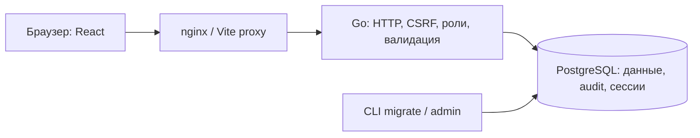

# Руководство по AIQ Core

AIQ Core объединяет сотрудников, учебные справочники, расписание, посещаемость и задачи. Документ описывает реализованное поведение. Порядок запуска и создания первого администратора находится в [README](../README.md), обслуживание — в [инструкции эксплуатации](operations.md), точные схемы запросов — в [OpenAPI](openapi.yaml).

## Архитектура

Backend — модульный монолит Go с `net/http` и pgx. PostgreSQL хранит данные, сессии, ограничения, версии миграций и audit. React + TypeScript обращается к API того же origin; Vite используется при разработке, nginx — в контейнере frontend.



`backend/internal/modules/` содержит auth, users, teachers, students, parents, programs, groups, lessons, attendance, tasks, dashboard и audit. Объединённого модуля families больше нет. Каждый HTTP-модуль использует `handler → service → repository`: handler читает запрос и оформляет ответ, service задаёт прикладные операции/чистые правила и публичные ошибки, repository выполняет SQL, транзакции и проверки, которым нужны заблокированные актуальные записи.

Финальная подготовка PATCH ученика и родителя выполняется политиками сервисного слоя после чтения и блокировки прежней карточки внутри транзакции repository. Проверки, запись и audit остаются атомарными. `platform/access.Begin` объединяет порядок административной блокировки и актуальную проверку роли/сессии. `platform/lessonstore` содержит общие загрузку и блокировку группы/занятия, московскую зону и перевод ошибок; расписание и посещаемость используют одну реализацию. При завершении/переносе функции модуля attendance работают в транзакции расписания, а не открывают вторую.

`internal/domain/people` и `internal/domain/lesson` содержат общие модели, позволяя избежать циклических зависимостей модулей. Общая формула процента остаётся в `platform/attendance`. SQL-миграции встроены в бинарники; текущая версия — 016. Сохранённый состав находится в `lesson_participants`, отметки — в `attendance` с PK/FK на участника. Представление `attendance_records` объединяет их для чтения, сохраняя внешний формат журнала. [Схема БД и доказательство сохранности миграции](database-schema.md).

## Роли

| Возможность | Администратор | Руководитель | Педагог | Куратор |
| --- | --- | --- | --- | --- |
| Пользователи, роли, блокировки | Управление | — | — | — |
| Педагоги | Управление | Чтение всех | Собственный профиль | — |
| Ученики, Student 360 | Все | Все | Ученики своих занятий, ограниченные сведения | Закреплённые ученики |
| Родители и контакты | Все | Чтение всех | — | Родители закреплённых учеников |
| Программы, группы, расписание | Управление | Чтение всех | Свои | Связанные с закреплёнными учениками |
| Посещаемость | Чтение и исправление | Чтение | Свои занятия | Чтение закреплённых учеников |
| Задачи | Управление всеми | Управление всеми | Свои, допустимые статусы | Свои, допустимые статусы |
| Dashboard | Да | Да | — | — |
| Audit Log | Только чтение | — | — | — |

При нескольких ролях разрешения суммируются. Backend проверяет роль и связь с объектом, включая запросы по ID. Ограниченные роли получают отфильтрованные данные; кнопки UI не заменяют серверную защиту. Подробная матрица: [роли и педагоги](roles-and-teachers.md).

## Основные сценарии

1. Создать первого администратора отдельной командой. Других сотрудников создавать через раздел «Пользователи», назначать роли и временные пароли. Сотрудник меняет временный пароль при первом входе.
2. Создать профили педагогов, при необходимости связать с аккаунтами. Создать учеников и родителей, указать семейные связи, основной контакт и куратора.
3. Создать программу, модули и активировать программу. Создать группу, назначить программу и педагога, задать вместимость. Зачислить ученика с датой начала.
4. Создать занятие, указать группу, педагога и время. Открыть журнал: состав фиксируется по зачислениям на дату занятия. Впоследствии изменения группы не переписывают этот снимок.
5. После начала занятия сохранить отметки. После окончания завершить занятие, когда все включённые ученики отмечены. Администратор может исправить завершённый журнал; педагог — только своё незавершённое занятие.
6. Создать задачи с исполнителем и сроком. Смотреть показатели в «Обзоре», критические изменения — в «Истории действий».

Карточки и группы архивируются вместо удаления. Завершение зачисления и перевод сохраняют прежнюю строку истории. Отмена занятия сохраняет занятие; внесённые отметки могут препятствовать отмене. Архивные ученики и группы продолжают участвовать в расчётах исторической посещаемости.

Контракты разделов: [ученики и родители](students-and-parents.md), [программы](programs-and-modules.md), [группы](groups-and-enrollments.md), [расписание](lessons-and-journals.md), [посещаемость](attendance.md).

## Общий контракт API

Префикс — `/api/v1`. JSON-списки пользователей, педагогов, учеников, родителей, программ, групп, занятий, задач, исполнителей задач и audit используют один формат:

```json
{
  "items": [],
  "total": 0,
  "page": 1,
  "page_size": 20
}
```

`page` начинается с 1; `page_size` — от 1 до 100, по умолчанию 20. Некорректный параметр даёт `400`. Страница после конца результата содержит пустой массив и прежний `total`. `total` учитывает фильтры и права пользователя. Сортировка:

| Список | Порядок |
| --- | --- |
| Пользователи | `id` |
| Педагоги, ученики, родители, программы, группы | `name_search`, затем `id` |
| Занятия | `starts_at`, затем `id` |
| Задачи | `due_at`, затем `id` |
| Исполнители задач | `name`, затем `id` |
| Audit Log | `occurred_at DESC`, затем `id DESC` |

ID разрешает равенство основного ключа сортировки. При изменении данных между запросами страницы могут сдвигаться: API использует пагинацию по номеру страницы. Вложенные массивы карточек, состав одного журнала и сводка Student 360 имеют собственный контракт снимка, без отдельных `page`/`page_size`.

Ошибки приложения:

```json
{
  "code": "validation_error",
  "message": "Проверьте введённые данные.",
  "field_errors": { "page_size": "Некорректная страница." },
  "request_id": "0123456789abcdef0123456789abcdef"
}
```

`field_errors` — объект, в том числе пустой. `request_id` совпадает с `X-Request-ID`; сервер генерирует его сам. Основные статусы: `400` — валидация, `401` — требуется вход, `403` — нет прав или неверный CSRF, `404` — объект недоступен/не найден, `409` — конфликт, `415` — требуется JSON, `429` — лимит попыток входа, `500` — внутренняя ошибка, `503` — сервис/БД недоступны. API Audit Log возвращает `405` при попытке записи администратора. Nginx возвращает тот же JSON-формат при превышении своего лимита (`413`) или недоступности backend (`503`).

Вход: получить `/auth/csrf`, сохранить cookies, отправить `/auth/login` с `Origin` и `X-CSRF-Token`; после входа использовать новый `csrf_token`. Все POST/PATCH/PUT/DELETE защищены CSRF. Ответы сессии не кешируются. Клиент не хранит сессионный токен в localStorage.

## Валидация и интерфейс

Backend проверяет JSON, типы, длины, обязательные поля, роли, статусы, даты и допустимость связей. Неизвестные JSON-поля запрещены. PATCH проверяет итоговую карточку внутри транзакции. PostgreSQL дополнительно обеспечивает FK, уникальность и бизнес-ограничения, включая конкурентные записи.

Frontend проверяет обязательные поля, email, длины и порядок дат, показывает сообщения полей из backend. Пароли: минимум 12 Unicode-символов и максимум 72 байта UTF-8. Комментарий посещаемости: максимум 500 Unicode-символов. Расписание отображается и вводится по Москве; API передаёт время с часовым поясом.

На экранах предусмотрены загрузка, повтор после ошибки, пустой результат и подтверждение успешного сохранения. На время записи кнопки блокируются. Интерфейс адаптирован от 360 px; широкие таблицы используют прокрутку внутри таблицы. Браузерные тесты проверяют desktop 1440 × 1000 и mobile 360 × 800, горизонтальное переполнение и доступность через axe.

## Dashboard и Student 360

Предупреждения дублей, возраст, снимки и перенос занятий, closed_at и строгие переходы задач: [инструкция P1](completion-p1.md). Основной маршрут карточки — /overview, старый /360 сохранён.

Dashboard содержит активных учеников, группы и педагогов, занятия сегодня, посещаемость за период и просроченные задачи. Период по умолчанию — весь текущий календарный месяц по Москве, включая последний день. Даты включительны. Только посещаемость зависит от выбранного периода.

Общая формула обоих разделов:

```text
(present + late) / (present + late + absent + excused) × 100%
```

Считаются отдельные отметки включённых учеников завершённых занятий. `unmarked`, отменённые и запланированные занятия не входят в знаменатель. При отсутствии отметок возвращается `null`, отличающийся от `0%`. Проценты групп не усредняются. Подробнее: [Dashboard](dashboard.md).

В ограниченной Student 360 педагога поля ученика содержат только `id`, `name`, `status`; приватные ключи отсутствуют в API и UI. Дополнительная роль куратора открывает полную карточку только закреплённого ученика. Ответственный связанной задачи проверяется по тем же условиям чтения объекта; после отзыва доступа связь скрывается в ответах задачи. Статус завершения полного ТЗ: [completion-progress.md](completion-progress.md).

## Audit и технические логи

Успешное критическое изменение и audit-запись сохраняются в одной транзакции. Запись содержит время, автора, действие, тип/ID объекта, названия изменённых полей и `request_id`. Новые audit-записи не содержат значений паролей, токенов, контактов и свободных текстов. API доступен только администратору и не предоставляет редактирование или удаление; БД также блокирует UPDATE/DELETE audit. Исторические записи сохраняются; их внутренние `details` API не выдаёт. Подробности: [Audit Log](audit-log.md).

Технические логи — JSON. Backend пишет шаблон маршрута, HTTP-метод, статус, длительность и request_id. Исходные ошибки БД не печатаются; SQLSTATE сохраняется отдельно, если доступен. Nginx пишет request_id, статус и длительность. Тела, cookies, пароли, email, телефоны, адреса клиентов и query strings исключены. Неструктурированные HTTP-ошибки заменяются безопасным событием. Audit содержит имя автора при чтении для администратора и является отдельным защищённым журналом, а не техническим логом.

## Демонстрационные данные и ограничения

Автоматического учебного seed нет. Тесты и изображения используют вымышленные имена и email домена `example.test`; тестовые пароли служат только проверкам. Для собственной демонстрации используйте вымышленных сотрудников, учеников, родителей и контакты; не загружайте настоящие данные в демонстрационную среду. Первый администратор создаётся с явно заданным паролем, пароля по умолчанию нет.

Текущая версия не предоставляет кабинет ученика/родителя, публичную регистрацию, почтовое восстановление пароля, экспорт интерфейса или автоматическое расписание резервного копирования. HTTPS настраивается внешним proxy. Миграции имеют только прямое направление; rollback планируют через восстановление БД и совместимую версию приложения.

Результаты и границы проведённых проверок: [validation.md](validation.md). Соответствие общим требованиям: [general-requirements.md](general-requirements.md).
